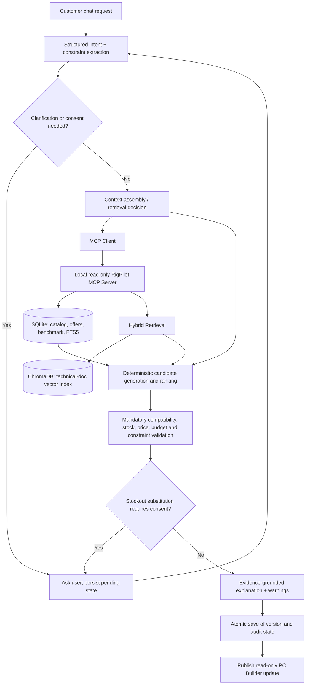

# RigPilot — AI Architecture & Evaluation Design

**Date:** 2026-11-04  
**Status:** DESIGN APPROVED by stakeholder on 2026-11-04; implementation requires a separately reviewed and approved plan  
**Scope:** AI recommendation, retrieval, tooling, workflow state, observability and evaluation. Product behavior remains owned by [Product & UX Design](2026-11-04-rigpilot-product-design.md); accepted stakeholder decisions by [Decision Log](../../DECISIONS.md).  
**Evidence baseline:** `hungtvb/rigpilot`, `docs/foundation-decisions`, documentation-only. This document defines **TO-BE** architecture; no runtime, evaluation PASS, benchmark or chosen ShopMate reusable module has been verified.

## 1. Goal and boundaries

RigPilot helps a customer produce and refine **one best-fit, technically assessed PC build** from a simulated shop catalog, with explicit budget, stock, compatibility and evidence limitations. Natural-language reasoning must not override authoritative structured data or deterministic hardware rules.

**Required V1 capabilities:** OpenAI LLM and embeddings, RAG over technical documentation, Hybrid Retrieval, structured catalog/benchmark lookups, a local read-only MCP tool boundary, a controlled workflow, customer approvals, private conversation-specific context, versioned results, recovery and auditable evaluation.

**Not in scope:** checkout/cart functionality, live internet search during chat, automatically scraping entire hardware market, customer profile memory shared across chats, an admin UI, a farm of domain agents, Elasticsearch, dedicated reranker service, broad production infrastructure or auto-certified benchmark facts.

## 2. Architecture alternatives and chosen direction

| Approach | Benefits | Cost / limitation | Direction |
|---|---|---|---|
| Free-form LLM agent with tools | Flexible, fast prototype | Can skip required checks, poor correctness control | Rejected |
| Controlled single LangGraph workflow with specialized tools and deterministic engines | Predictable guardrails, observable, easy to evaluate, fewer handoffs | Less flexible for future autonomous specialist tasks | **Designer-recommended V1** |
| Multiple autonomous agents coordinating decisions | Clear specialized roles for large workload | Higher cost, complexity, difficult handoffs and shared state | Defer until measured need |

**Stakeholder-accepted:** Hybrid Agentic, controlled mandatory verification, read-only local MCP, RAG and local storage choices.  
**Designer decision proposed for approval:** one controlled LangGraph orchestrator with specialized nodes/tools; **not** four independently autonomous agents. Add an agent only when a measured scenario demonstrates that existing workflow cannot serve it.

### TO-BE logical architecture

This is a **conceptual control/data flow**, not an exact LangGraph node topology or a claim of executed tools. Pure domain engines may call the same repository/query adapters without traversing MCP where the app owns the call; the external-to-agent lookup boundary is MCP.

## 3. AI technology stack

| Concern | Selected / proposed technology | Owner and reason |
|---|---|---|
| LLM | **OpenAI API** (stakeholder selected; model id configured) | Intent extraction, clarifications, grounded explanation, bounded tool decisions |
| Embedding | **OpenAI Embeddings API** | Embed vetted technical-document chunks and retrieval queries |
| Orchestration | **LangGraph** (designer proposal) | Typed graph state, explicit checkpoints, bounded loops, interrupts and mandatory gates |
| LLM/tool adapters | **LangChain** where it reduces boilerplate | Loader, model adapter, tool wrappers; avoid opaque chains for safety rules |
| Schemas | Python 3.12, Pydantic / typed graph state (proposal) | Validate contracts and agent-produced state patches |
| Structured data | **SQLite**, with FTS5 for keyword lookup | Transactional catalog, synthetic price/stock, benchmark rows, auth/conversation/version records |
| Vector index | **ChromaDB**, local persistence | Document embeddings, chunk metadata and semantic retrieval; not authoritative for prices/stock |
| MCP | **One local read-only MCP Server**, client in orchestrator | Stable tools for product/spec/stock/knowledge reads; no domain writes |
| Compatibility / optimizer | Deterministic Python domain modules | Hardware rules and measurable candidate ranking; not LLM adjudication |
| Tracing / evaluation | **LangSmith** with redacted metadata plus pytest/custom evaluators | Reproducible traces, experiments, cost/latency and correctness |
| E2E UI when built | Playwright (proposal) | Browser flows and cross-session isolation |

**Local-first:** data and app run locally; LLM/embedding calls use OpenAI over network. Exact package versions, auth library and deployment mechanics are implementation-plan tasks, not asserted here.

## 4. Sources of truth and data provenance

| Information | Authority | Retrieval mechanism | Failure behavior |
|---|---|---|---|
| Canonical product ID and technical specs | Curated/validated SQLite product records with manufacturer citations | Exact-model lookup | Unknown specs => `UNVERIFIED` |
| Price and availability | Synthetic SQLite offers and stock snapshots | Structured query with snapshot timestamp | Unknown != 0 != in-stock; price unknown => cannot certify budget |
| Benchmark measurements | Structured SQLite measurement table + source/conditions | Filter on comparable test conditions | No fabricated FPS or cross-condition ranking |
| Manufacturer manuals / game docs / reviews | Original curated documents, versioned with links/hashes | Chroma + SQLite FTS5 | No relevant source => qualify or refrain from specific claim |
| Chat state and build versions | Account-scoped SQLite records; LangGraph checkpoints for ongoing workflow | Authenticated account/conversation queries | No stale run publishing; history immutable |

Store documents outside vector index as original source files/links. Chroma is a **derived index**; rebuilding it cannot change the authoritative product, price or benchmark records.

Data import/refresh remains file-based (JSON/CSV/PDF/HTML/Markdown/TXT); **no admin UI**. Ingestion is separate from customer chat, and documents are not fetched from the live web on user requests.

## 5. RAG ingestion and retrieval

### Ingestion
1. Curate and identify sources (publisher/manufacturer, URL, document ID, retrieval/publication date, license, product ID or application).
2. Parse text and tables with source structure and page/section references; flag parsing failures and non-machine-readable tables for review.
3. Normalize exact model identifiers (including suffixes such as `SUPER`, `Ti`, product revision, memory capacity) without collapsing distinct SKUs.
4. **Structure-aware chunking:** keep headings, table headers/units, row meaning and page context; apply size limits only after structural splits.
5. Deduplicate deterministically; store hash, document version, chunk ID, source location, `product_id` or application, source kind and date.
6. Compute OpenAI embeddings and upsert into Chroma using stable IDs; synchronize searchable text/metadata into SQLite FTS5. Support reindex/version rollback without duplicate chunks.

### Hybrid retrieval
- Identify exact entity IDs / games / app versions first; filter sources to that product/revision/setting where possible.
- Query Chroma semantic similarity and SQLite FTS5/exact-match **independently**.
- Merge candidate passages by stable chunk ID (a simple Reciprocal Rank Fusion is the **designer starting point**), deduplicate, filter mismatched models, and order evidence by relevance and source authority.
- Return `chunk_id`, `source_id`, URI/page/section, product/revision, publication date and confidence caveats. Retrieval score is **not a factual truth score**.
- Validate citations against the returned evidence. Customer-visible explanation must distinguish **official requirements**, **measured third-party benchmark**, and **inferred guidance**.
- Treat documents as untrusted data: ignore embedded instructions telling the agent to change tools, reveal secrets or skip verification. Retrieval never grants access to unauthorized account data.

### Structured benchmarks
Extract only attributable measurements (tested GPU/CPU and other relevant system parts; game/software version, resolution, settings, upscaling/frame generation, metric type such as avg or 1% low FPS, source, date). Where conditions are incompatible, **do not** directly compare numeric values. Keep analysis/commentary in RAG and the verified measurement fields in SQLite. Importer checks units/keys and quarantines ambiguous readings.

## 6. Context, memory and versions

Use **structured state as authoritative current intent**, with conversation memory as supporting narrative. Each chat is isolated; no automatic reuse of profile preferences across chats.

Proposed state fields:
- `conversation_id`, `run_id`, `account_id` (internal; do not expose to tools/telemetry unnecessarily).
- `budget_max`, `currency`, `workloads` with priority, relevant games/apps and assumptions.
- `hard_constraints`, `soft_preferences`, `locked_parts`, `owned_parts` with exact/provisional IDs.
- `pending_approval` (explicit request/target/reason and decision state), and latest applied `build_version_id`.
- `catalog_snapshot_id`, `retrieval_sources`, `candidate_build`, `validation_report`, `execution_status` and `state_revision`.

LLM outputs **proposed patches** via schema validation; they are not applied before checking that constraints are consistent and that explicit user approval is present. Do not overwrite a locked part or assume a pending approval was granted. Summaries can reduce prompt tokens but cannot replace original transcripts or applied state.

**Checkpoint ≠ build version.** A checkpoint may contain incomplete work and unverified parts. Only atomic persistence of a validated-and-warned final build creates an immutable customer-visible version. 'Restore old' creates a new version, not a destructive update.

## 7. Controlled workflow, recovery and concurrency

1. **Classify request:** question / clarification / new build / refinement / approval / history action.
2. **Extract/merge typed constraints:** one decisive follow-up when required; otherwise use explicit assumptions with warnings.
3. **Acquire evidence:** LLM may decide when RAG helps; structured catalog/stock and final validators are mandatory for building a configuration.
4. **Generate/rank candidates deterministically** using hard requirements and user-prioritized workloads; prefer meaningful value rather than automatically exhausting budget. 'Best' remains conditional on evidence and the defined scoring rubric.
5. **Validate every final candidate:** compatibility, inventory, budget/unknown-price, owned hardware, mandatory parts and known user constraints. Produce `COMPATIBLE`, `UNVERIFIED` or `INCOMPATIBLE` with reasons; missing data is never converted into a PASS.
6. **Consent gates:** if an out-of-stock part must be substituted, interrupt and ask the customer; never auto-substitute solely to complete the run. Over-budget and locked-part violations require explicit decision.
7. **Finalize with sourced explanation** and warning summary; save/version/publish only if current run is still authoritative.
8. **Expose real execution events** to compact expandable Chat progress. Retries and skipped/failure status must be factual.

**Graceful degradation:** bounded retries + timeouts for read-only MCP and retrieval. If stock cannot be read => `UNKNOWN`; if price cannot be read => cannot claim under-budget. If compatibility-critical fields are missing => `UNVERIFIED`; if optimizer cannot produce an assessed build => keep the previous published version. Nothing silently turns unverified into compatible or available.

**Checkpoint recovery:** use LangGraph persistent checkpoints (SQLite-backed solution proposed, version-compatible package verified before implementation). Resume from a valid checkpoint; invalidate dependent work when constraints/catalog snapshot or user approval changes. Do not replay approval or write operations. End-to-end `run_id` + idempotency key prevents duplicate build versions.

**Designer default for concurrent messages:** latest user intent wins in the same conversation. When a newer message materially changes a running build, cancel obsolete computation on best effort, start a new run with updated state, and **reject stale result publication** with a run/revision compare-and-swap inside the SQLite transaction. Do not blindly restart all turns; informational follow-ups may be handled without invalidating a build if safe. A queued sequential model is simpler but risks publishing a build the user has already superseded.

**Loop safeguards:** bounded tool-call count, retry budget, wall-time budget and explicit terminal failure; exact limits will be chosen and tested during implementation.

### Optimizer policy — designer default for V1

Use a **bounded deterministic candidate search** rather than LLM inventing a parts list and grading itself:

1. Enumerate plausible compatible combinations from the catalog, pruning by mandatory hardware constraints, the customer's locked/owned parts and documented part requirements.
2. Exclude known out-of-stock substitutions from automatic publication until consent is obtained. An unknown-stock part may remain a **provisional** candidate with a visible warning, never an assumed available offer.
3. For each workload, estimate **relative suitability only from normalized comparable evidence** (supported game/software requirements and measurements with matching conditions). Unknown evidence lowers confidence and may prevent exact ranking; do not impute arbitrary FPS.
4. Reject candidates dominated by another candidate that meets at least the same evaluated needs and costs no more without worsening important constraints. Among remaining candidates, prefer stronger fit to the **primary** workload, then avoid paying materially more for gains within evidence uncertainty; use price and upgradeability as tie-breakers only after respecting user priorities.
5. If no feasible candidate satisfies all hard requirements, provide the nearest **explicitly noncompliant** configuration with itemized blockers and request an authorized constraint change; never silently reinterpret a hard constraint.
6. Save the rationale: rejected alternatives, constraint evaluations, evidence IDs and the reason the selected build is preferable. The final ranking remains a **designer hypothesis** until calibrated against reviewed golden scenarios.

This is an explainable **value-first heuristic**, not a proof of global optimum. A linear solver / OR-Tools can be considered later only if catalog scale or scenario tests expose a real gap; exact utility weights and thresholds must come from evaluation evidence, not invented benchmarks.

## 8. Privacy and security

- **Privacy-aware LangSmith tracing:** default to trace metadata (anonymized correlation ID, node/tool name, duration, token/cost usage, result status). Do not send complete prompts/responses, email, secrets, owned-component personal narratives or unredacted tool payloads by default. Debug content is opt-in, time-limited, controlled and redacted.
- OpenAI API is a separate data recipient; only send context necessary for the current task. Define retention and provider policy at implementation time.
- Account authentication and authorization guard conversation/history/version reads **before** any LLM or MCP interaction. A user's request to 'open version 7' cannot override the account filter.
- MCP tools are **read-only**; allowlisted tool names and typed arguments, bounded query sizes and no arbitrary SQL, filesystem, network URLs or raw credential passthrough.
- Keep API keys server-side; sanitize document text as untrusted; guard against prompt injection, cross-document source spoofing and prompt/log PII leaks.
- Track imported data provenance and license compliance. Simulated shop stock/prices are clearly labeled synthetic.

## 9. Evaluation strategy (design, not results)

**Approach accepted:** deterministic correctness + AI-assisted reference builds with human review. Do not use exact-part-match as primary recommendation quality oracle. Reviewers score user constraints, performance evidence, balance/value and explanation.

| Layer | Independent oracle and method | Key failure modes |
|---|---|---|
| Compatibility & safety | Deterministic fixtures + product-spec oracle; automated assertions | False compatible, ignored hard lock, wrong socket/RAM/PSU/fit |
| Optimization | AI-generated candidate references checked mechanically, then human-**reviewed** expert rubric | Infeasible choices, wasted spend for marginal gain, overlooked primary workload |
| Retrieval / RAG | Labeled query-document relevance; Recall@k/MRR; source and citation assertions | Wrong exact model, missing table context, bad source, invented FPS |
| Agent / context | Multi-turn scripted scenarios with expected state and approvals | Lost budget changes, false approval, wrong session, no warning |
| Reliability/security | Fault injection, concurrent runs, owner isolation, checkpoint replay/idempotency | Stale publication, duplicate versions, data leakage, infinite retries |
| Operational | Real-call traces, token estimates, p50/p95 latency and model cost by case | Unbounded calls, slow runs, inefficient retrieval |
| Business value | Same catalog: user self-selection vs RigPilot; time to checked build, mistakes, effort | No improvement over a good filtered catalog UI |

**Golden dataset status:**
- `PROVISIONAL`: AI generated scenario/reference, not an authoritative answer.
- `VALIDATED`: deterministic safety/constraint checks passed on named snapshot; still not expert-approved.
- `REVIEWED`: independent qualified reviewer checked business suitability and provenance.
Use the REVIEWED subset for the highest-confidence recommendation-quality comparison. Track unreviewed cases for development/coverage, not as expert-quality evidence. Start with a compact, diverse dataset (initial planning envelope ~40–60 cases, adjustable after catalog coverage), including gaming, creator, mixed workload, owned parts, stockouts, incompatible hardware, missing benchmark, clarification, memory, approval, recovery and cost/latency regressions.

**Proposed acceptance gates (must be calibrated):**
- Zero known critical violations on the defined deterministic suite: budget breach without consent, hidden known incompatibility, unsupported 'in-stock' claim, unauthorized data read, unauthorized stockout substitution, duplicate/stale publish.
- Every customer-visible quantitative performance claim has a matching source and comparable conditions; otherwise omit numbers or label uncertainty.
- Retrieval, answer quality, median/p95 latency and token cost targets to be baselined on reviewed golden data rather than fabricated now.
- For human quality review, score workload fit, compatibility, budget/value, evidence and explanation separately; critical violations **cannot** be averaged away by a high narrative score.

**CI / evaluation cadence:** every code PR runs deterministic/unit/integration and importer checks; AI/RAG-sensitive PRs trigger targeted real OpenAI smoke tests; before major AI merges run a selected full multi-turn E2E suite; scheduled deeper regressions catch drift. Costly full LLM evaluation does **not** run on every trivial/docs PR. Store dataset version, revision SHA, model, run date, mode, counts, failures and LangSmith experiment URL where available; no evaluation has been run yet.

## 10. What gets implemented after design approval

1. Validate curated data contracts and build importer (SQLite + Chroma index) **before** large-scale ingestion.
2. Implement deterministic compatibility and optimizer with reference scenarios **before** entrusting recommendation to LLM.
3. Implement read-only MCP and hybrid RAG retrieval with standalone retrieval evaluation.
4. Add LangGraph typed context, controlled orchestration, approvals, checkpoints and atomic version persistence.
5. Integrate chat/PC Builder events and history; add real-model E2E, security and business evaluation.

**Source reuse caveat:** ShopMate source is stakeholder-owned and selective reuse is agreed, but specific code, licenses and dependencies are **not audited in this repository**. Do not claim a reusable component until reviewed at a named source commit.

**Design review gate:** The stakeholder approved this design baseline on 2026-11-04, including documented designer defaults. Implementation plans now follow under `docs/superpowers/plans/YYYY-MM-DD-<feature>.md` and require their own review before any application code is written. This documentation PR does not implement the architecture.
