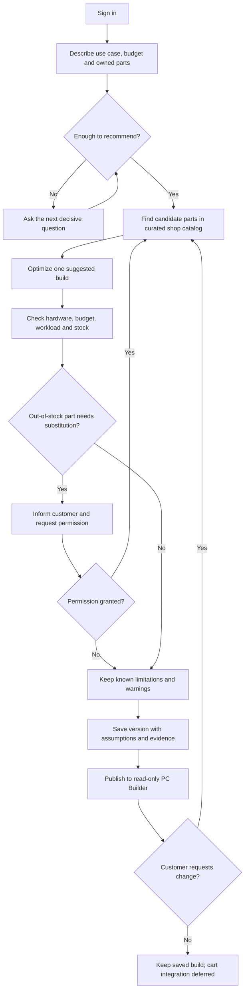

# RigPilot Agentic AI — Product & UX Design (APPROVED DESIGN)

**Draft date:** 2026-11-04  
**Phase:** Design approved by stakeholder on 2026-11-04. Separate implementation-plan review is required before coding.  
**Authority:** Stakeholder-confirmed decisions in [Decision Log](../../DECISIONS.md). Related implementation-facing design: [AI Architecture & Evaluation](2026-11-04-rigpilot-ai-architecture-design.md) (APPROVED DESIGN).  
**Current repository state:** Documentation initialization only; no RigPilot application, data import, benchmark, tests, or live agent execution verified here.

## 1. Why RigPilot exists

Customers of a PC components retailer may understand their workload and budget but not how to choose compatible parts, estimate appropriate performance, balance costs, reuse owned hardware, and preserve a configuration through multiple conversations. Existing product filters or manual checkout lists do not by themselves resolve all these interacting constraints.

**RigPilot** is a conversational advisor for a **simulated PC-components shop**: it elicits the necessary requirements, proposes **one best-fit PC**, explains the rationale and limitations, and lets a signed-in customer iteratively refine and save the build. It must never describe an unsupported recommendation as guaranteed optimal.

**Who uses it:** a customer building or upgrading a PC; not a store employee or inventory manager.

**Hypothesized value (not measured):** less effort in selecting parts; fewer overlooked compatibility issues; more transparent budget and performance trade-offs; easy return to saved builds. Metrics and a comparable non-AI baseline still need definition.

## 2. Scope

### In scope at the product level
- Gaming, office, programming, 2D design, video, 3D, AI/ML; ask for priority when multiple workloads compete.
- One recommended PC build at a time, from a real-model curated catalog with **synthetic shop price/stock**.
- Tower by default, optionally including requested screen/peripherals in the stated budget.
- Clarify missing decisive information, such as game names, before recommending; avoid repetitive interrogation.
- Refine by chat, automatically updating dependent parts when permitted, with change notes and fresh validation.
- Keep known incompatibilities and unknowns visible; customer can continue with a warned configuration.
- Reuse already-owned components; known model preferred, provisional assumptions and warnings otherwise.
- Account-scoped conversation and versioned build history; preview old versions and restore as a **new** version.
- Read-only desktop/mobile PC Builder and source-backed performance explanations.
- Compact, real execution progress and explicit failure state.

### Not in this initial release
- A functional cart, inventory reservation, payment, checkout, order fulfillment or refund processing.
- Admin UI, real shop integration, live web research during customer chat.
- Side-by-side history version comparison; direct component editing in builder.
- A2A, Deep Agents or arbitrary multi-agent complexity without a demonstrated use case.
- Claims that all use cases have measured FPS/throughput data or that the system is production-ready.

A disabled/clearly marked **Proceed to Cart** CTA may be present as a future integration affordance; it must not imply that a cart was created. The earlier proposed future cart rules live in the decision log only.

## 3. Main customer journey (target, not implemented)

This flow describes **business responsibilities**, not a finalized number of agents, graph nodes or LLM calls.

### Example acceptance scenarios (proposed for test planning)
1. **Gaming ambiguity:** Customer supplies 25M VND for gaming. Ask game names; after 'Valorant and CS2', produce a single build with explicit FPS/resolution assumptions and explain why CPU/GPU were selected.
2. **Mixed use:** Customer wants Cyberpunk, Blender, and local AI in a fixed budget. Ask primary priority before allocating budget; report trade-offs.
3. **Part change:** Customer asks to swap AMD CPU to Intel; system may adjust motherboard/cooling as needed, records precise reasons and a new version.
4. **Stockout:** Top candidate GPU has verified zero stock; do not silently substitute. Ask customer before choosing an alternative.
5. **Owned GPU:** Customer has RTX 4070 but unknown vendor/model; propose a provisional build and mark case clearance and power connector details unverified.
6. **Known conflict:** Customer insists on an incompatible CPU/mainboard combination. Preserve the choice and explicit serious warning; never label it compatible.
7. **Budget revision:** Reduce target from 30M to 27M VND; optimize under the permitted constraints, explain unmet requirements, and version the accepted result.
8. **History:** Switch conversation, preview a prior build, restore it as a new version; previous versions and original dialogue remain intact.
9. **Failure:** Recommendation or validation fails; previous saved build remains visible; chat shows a recoverable failure with no phantom version.
10. **Evidence:** If no relevant benchmark source exists, use a qualitative statement rather than fabricated FPS.

These are **proposed acceptance cases**, not PASS evidence.

## 4. Business rule boundaries

- **Best-fit** depends on explicit use case and customer constraints, not simply maximum component price or raw synthetic score.
- **LLM may interpret intent and explain rationale.** Engineering compatibility must be checked against structured, verifiable constraints; no unsupported socket/clearance/PSU/BIOS claim.
- **Availability states are distinct:** in stock, out of stock, unknown/stale. Do not treat unknown as zero or as available.
- **Risk is visible, not hidden:** compatible / unresolved / incompatible are different. A user may keep an incompatible list; a validated *warning* is not a validated *working PC*.
- **Substitution requires consent** when triggered by a stockout. Customer-driven replacement may adjust dependent parts and must leave a clear change note.
- **Budget breach requires choice.** If only a dearer build meets a goal, explain and offer a decision instead of silently exceeding a limit.
- **Existing hardware** participates in physical checks but is excluded from proposed purchases/remaining budget.
- **Performance evidence:** retain game/application name and version where applicable, test hardware, settings/resolution, FPS/metric type, source URL and publication/capture date; missing evidence yields uncertainty, not invented precision.
- **Atomic publication:** only a saved and checked version reaches Visual PC Builder; warnings are allowed after checks complete. Failed work must not mutate the active version.

## 5. Data boundaries

| Dataset | Intended source of truth | Notes |
|---|---|---|
| Product catalog & technical specs | Curated records for **real manufacturers' part models** | Include model identity, spec fields relevant to compatibility and provenance |
| Shop offers | **Simulated** price and stock records | Date/state explicit; no promise of real-world availability |
| Games & software requirements | Curated official vendor/publisher requirements | Distinguish minimum/recommended from measured performance |
| Performance benchmarks | Verified third-party/manufacturer test records where credible | Annotate scenario and limitations; never invent FPS |
| Customer history | Local persisted account-scoped conversation and immutable build versions | Implement auth, retention, ownership and restore rules later |

Initial data set should be **small and scenario-complete**, not an exhaustive market index. Files (CSV/JSON as appropriate) with validation/import scripts are accepted. **SQLite** is selected for structured data and **ChromaDB** for document embeddings (D-047/D-048); exact schema, item counts and source licenses remain under design.

## 6. Product UX (accepted choices)

- **Style:** Modern SaaS + Premium Hardware; restrained visual hierarchy and product-centric imagery. Exact tokens and dark-mode scope are **not decided**.
- **Desktop-first:** after login, open Chat alongside a **read-only** Compact List PC Builder. History entry is accessible without replacing the main flow.
- **Mobile:** exactly two tabs, **Chat** and **PC Build**; new recommendations do **not** auto-switch tabs. A clear 'Cấu hình đã cập nhật — Xem PC Build' affordance is shown.
- **Builder:** per-component thumbnail, precise model, key specs, price, inventory and compatibility state; whole-build status **summary** plus **inline** details and evidence limitations. Keep version-aware warnings.
- **History:** timeline drawer with version label, short rationale and preview/restore action; no two-version comparison initially.
- **Progress:** compact Chat status, expandable into real steps from execution events, with completed/running/skipped/failed; no animated fabricated progress.
- **Update behavior:** retain last saved configuration while thinking; after full checks and save, publish new version. Preserve last version on failure.
- **CTA:** 'Proceed to Cart' **not functional yet**, with a clearly disabled/upcoming state.

Essential pending UI checks: responsive breakpoints, keyboard/AT navigation, focus management for drawer/tab controls, loading/empty/error states, product-image fallback and color contrast.

### Prototype v0.4 — visual and interaction review (PROPOSED)

**Phase:** Mockup design only. This section is a **review proposal**, not a new accepted business rule, product implementation requirement or assertion that the simulated flows are real. Reviewed against the existing standalone v0.4 desktop (1440px) and mobile (375px Chat / PC Build) screenshots. No customer usability study or WCAG audit has been performed.

**Keep unchanged:** accepted two-pane desktop layout (Chat / read-only PC Builder), two mobile tabs, compact component list, budget summary, summary + inline warning concept, History Drawer, and mock state transitions. Do not redesign the shell or add a marketing hero.

| Priority | Visual / interaction finding | Mockup-level refinement |
|---|---|---|
| P1 | **Brand expression is still generic.** The logo and indigo palette are coherent, but the uppercase tagline and some generic SaaS copy do little to convey a PC-building assistant. | Refine only the identity microcopy and typography hierarchy; avoid extra ornamental cards, gradients or gaming decoration. |
| P1 | **Warning information competes with the components.** The summary card and repeated notices above the parts list are both visually prominent. | Preserve accepted **summary + inline** information, but make one overview line clearly primary and move detail emphasis beside affected components or behind disclosure, rather than repeating equally heavy blocks. |
| P2 | **Mobile header actions are ambiguous without labels.** The narrow screenshot uses icon-only History and New Session controls and a truncated state selector. | Provide recognizable accessible names/visible context (for example in tooltips or a compact action menu) and maintain touch-target hierarchy. No new navigation model. |
| P2 | **Category illustrations are visually generic.** They currently act as hardware-type placeholders, not true catalog photographs. | Keep placeholders valid in the mockup and identify them as illustrative. Real exact-model product photography and provenance are production-data concerns, not a mockup sign-off gate. |

**Mockup design acceptance (review by looking at representative states; NOT functional E2E tests):**
1. Desktop 1440px: the customer immediately locates Chat, PC Builder, total/budget and the meaningful warning summary; long models and prices remain legible.
2. Mobile 375px: Chat / PC Build tabs and history/new-chat affordances are discoverable, the composer does not cover important controls, and a long answer can be visually reviewed without confusing the tab state.
3. Mock state examples (saved build, unknown compatibility, stockout, failure and previous-version preview) visually distinguish the intended states. **Sample prices, inventory, execution steps and chat replies may be scripted.**
4. Typography, color, icon style, borders, density and hardware imagery feel like one RigPilot visual system, not a collage of generic AI/SaaS widgets.
5. The meaning of Chat-based refinements, History preview and Restore is understandable from the depicted interactions or annotations; **the prototype need not call any API, optimizer, LLM, catalog or persistence layer**.

**Not mockup blockers:** real benchmark sourcing, SKU database completeness, compatibility calculation, stockout approval implementation, state/checkpoint persistence, real execution-event correctness, AI response quality, backend authentication or measured performance. Those remain owned by approved Product/AI design and later implementation/evaluation. Visual treatment should still **avoid claiming** sample outputs are live or certified.

**Design gate:** review the small visual refinements above; then stakeholder can sign off the **UI mockup** separately from functional completeness. Keep this section `PROPOSED` until explicit approval; do not silently modify `docs/DECISIONS.md`, merge, start an implementation plan or code the app.

## 7. Evolution strategy: choose what to reuse

**Selected:** **Selective Reuse** of stakeholder-owned ShopMate.

| Alternative | Trade-off | Status |
|---|---|---|
| Full refactor of ShopMate | Maximizes apparent reuse, imports unrelated return/refund/customer-service flows and existing correctness risks | Rejected |
| **Selective reuse** | Audit reusable LangGraph/MCP/LLM/telemetry/test infrastructure; implement PC-specific reasoning, catalog, compatibility, optimization, versioning and UX separately | **Accepted direction** |
| Full rebuild | Maximum architectural freedom, repeats proven foundations and costs more | Rejected |

**No specific module is accepted as safe to copy without repository inspection.** Prior ShopMate review had only static checks and selected offline tests; its complete integration behavior was not established. In particular, do not inherit post-write refund validation, replay-prone approvals or unverified A2A claims.

The application is local-first and will call OpenAI for LLM/embeddings (D-045). SQLite/ChromaDB, MCP, hybrid retrieval and controlled checkpoints are selected at direction level (D-046–D-061); the component contract and exact graph implementation are documented in the **approved design** [AI Architecture & Evaluation](2026-11-04-rigpilot-ai-architecture-design.md).

## 7a. Recommendation engine — confirmed direction, details pending

**Chosen approach: Hybrid Agentic (Decision D-042).** This is a responsibility boundary, **not** a finalized framework, agent-count or graph design.

- **LLM / conversational orchestration:** interpret goals and constraints, identify missing decisive information, ask for customer permission where required, initiate refinement and explain the outcome with evidence.
- **Structured product and compatibility logic:** source candidate parts from the curated catalog, check available inventory and simulated prices, validate physical/electrical/platform compatibility, budget and known constraints.
- **Deterministic/explainable optimizer:** choose a single best-fit candidate under user priorities and hard requirements; report when the best achievable build fails some goals.
- **Confirmed budget objective (D-043, qualified by D-044):** optimize value for the customer's primary workload **within** their budget ceiling, without assuming full budget must be spent. Between feasible builds, favor the cheaper one when the more expensive one offers only a marginal practical gain. The illustrative 25M/100% vs 29M/105% preference **does not create a universal 5% cutoff**, nor is it a real benchmark. Any ranking rule must consider workload-specific evidence and clarify meaningful benefit.
- **Evidence and warnings:** a recommendation is never certified solely because an LLM says it is optimal. Missing product specs or benchmark records remain unknown, and user consent is retained for out-of-stock substitution.
- **Technical details:** exact ranking formulas, contracts, agent topology, sequencing, state/persistence implementation and evaluation thresholds are handled in the [AI Architecture & Evaluation design](2026-11-04-rigpilot-ai-architecture-design.md). The stack and quality-assurance directions are approved as a design baseline; exact code-level contracts remain implementation-plan decisions.

## 8. Quality and risk hypotheses

| Risk | Control / evidence needed |
|---|---|
| Incorrect hardware compatibility | Rule-based test fixtures for sockets, memory type, board form factor, PSU/connector, case clearance and unknown specs |
| Optimizer picks weak/invalid 'best' build | Held-out scenario comparisons against explainable reference builds; check budget and workload constraints |
| Hallucinated benchmark, stock or price | Source-of-truth metadata, clear uncertainty, negative tests |
| Unconsented stockout replacement | Customer-confirmation state and regression tests |
| Stale or mixed build versions | Immutable versions, atomic publish, concurrency and restore tests |
| Identity isolation and credential safety | Authorized history lookup, password hashing, session controls and negative access tests |
| Inherited legacy defects | Source-level audit before selecting any reusable ShopMate code |
| UI misleading customer on pending cart | Disabled CTA, no fake cart or success event |

No ROI, performance gain or accuracy percentage has yet been measured. Later test evidence must identify revision, dataset, mode and observed outcome.

## 9. Ownership and next gates

This document owns **product outcomes, UX behavior and business rules**, not detailed AI workflow or evaluation implementation. Accepted choices are recorded once in the [Decision Log](../../DECISIONS.md). The [AI Architecture & Evaluation Design](2026-11-04-rigpilot-ai-architecture-design.md) owns technical design, RAG and retrieval, MCP, state, recovery, privacy and evaluation strategy.

**Remaining before implementation:** stakeholder approval of a concrete implementation plan, a source-verified initial catalog, hardware-rule scope and any selected ShopMate reuse audit. Only after approved specs should a separate implementation plan be authored under `docs/superpowers/plans/`.

**Status:** Design baseline approved on 2026-11-04. Documentation only; there is no implemented RigPilot agent, dataset, passing tests or verified user-facing application in this repository.
